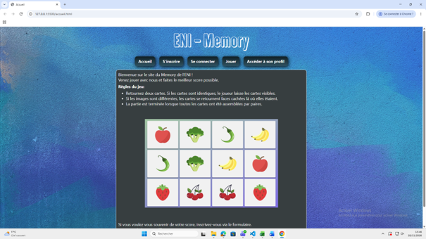
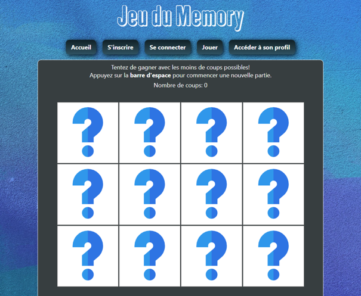
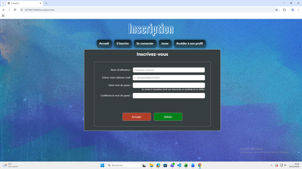

# 🃏 eni_memory

> Un jeu de Memory en **HTML, CSS et JavaScript**, avec pages d'accueil, de connexion, d'inscription et de profil.
> Projet réalisé dans le cadre de la formation **Développeur web et web mobile** à l'**ENI** (École Nationale d'Informatique).


  

---

## 🎯 Présentation

**eni_memory** est une version web du célèbre jeu de Memory : le joueur retourne des cartes deux par deux pour retrouver toutes les paires.

Ce projet est un exercice de formation. Je l'ai volontairement codé moi-même, étape par étape, afin de consolider mes bases en développement front-end : structure HTML, mise en page CSS et logique JavaScript.

## ✨ Fonctionnalités

- 🏠 **Page d'accueil** : présentation du jeu et navigation
- 🔐 **Page de connexion** : accès au compte du joueur -> en cours
- 📝 **Page d'inscription** : création d'un compte joueur: nom, adresse mail, mot de passe avec niveau de fiabilité
- 🎮 **Page de jeu** : plateau de cartes face cachée (image de point d'interrogation), à retourner pour trouver les paires
- 👤 **Page de profil** : espace personnel du joueur -> en cours

## 🛠️ Technologies utilisées

| Technologie               | Utilisation                                               |
| ------------------------- | --------------------------------------------------------- |
| **HTML5**                 | Structure des pages et plateau de jeu (tableau de cartes) |
| **CSS3**                  | Mise en forme, mise en page, effets visuels               |
| **JavaScript**            | Logique du jeu et interactions                            |
| **Live Server** (VS Code) | Test en local                                             |

## 📁 Structure du projet

````
eni_memory/
├── html/
│   ├── accueil.html
│   ├── connexion.html
│   ├── inscription.html
│   ├── jeu.html
│   └── profil.html
├── css/
│   ├── style.css
│   ├── accueil.css
│   ├── connexion.css
│   ├── inscription.css
│   └── jeu.css
├── js/
│   ├── inscription.js
│   └── jeu.js
├── fonts/
├── ressources/
└── screenshots/


## 🚀 Lancer le projet

1. **Cloner** le dépôt :
   ```bash
   git clone https://github.com/<lornithorynque46>/eni_memory.git
````

2. **Ouvrir** le dossier dans [Visual Studio Code](https://code.visualstudio.com/)
3. Lancer la page d'accueil avec l'extension **Live Server** (clic droit sur `html/accueil.html` → _Open with Live Server_)

Aucune installation de dépendances n'est nécessaire.

## 🎮 Règles du jeu

1. Toutes les cartes sont face cachée.
2. Clique sur une carte pour la retourner, puis sur une deuxième.
3. Si les deux images sont identiques, la paire reste visible.
4. Sinon, les cartes se retournent de nouveau.
5. La partie est gagnée quand toutes les paires sont trouvées.

## 📚 Ce que ce projet m'a appris

- Construire un **plateau de jeu en HTML** (tableau de cartes avec images)
- **Manipuler le DOM** avec JavaScript (afficher, changer et comparer des images)
- Organiser un projet **multi-pages** (accueil, connexion, inscription, jeu, profil)
- Structurer mon code et **comprendre ma propre logique** plutôt que copier une solution

## 🔭 Pistes d'amélioration

- [ ] Ajouter un chronomètre
- [ ] Proposer plusieurs niveaux de difficulté et différents choix de memory
- [ ] Mémoriser les meilleurs scores dans le profil
- [ ] Rendre l'interface entièrement responsive
- [ ] Ajouter des effets sonores

## 👩‍💻 Auteure

**Laure Cordon**
Ancienne professeure des écoles (13 ans d'enseignement), aujourd'hui en reconversion dans le développement web et web mobile à l'ENI.

- 🔗 GitHub : [@lornithorynque46](https://github.com/lornithorynque46/Eni_memory_laure)
- 💼 LinkedIn : [laure-cordon](https://www.linkedin.com/in/laure-cordon/)

---

_Projet pédagogique réalisé dans le cadre de la formation ENI. Contributions et retours bienvenus ! 🙂_
